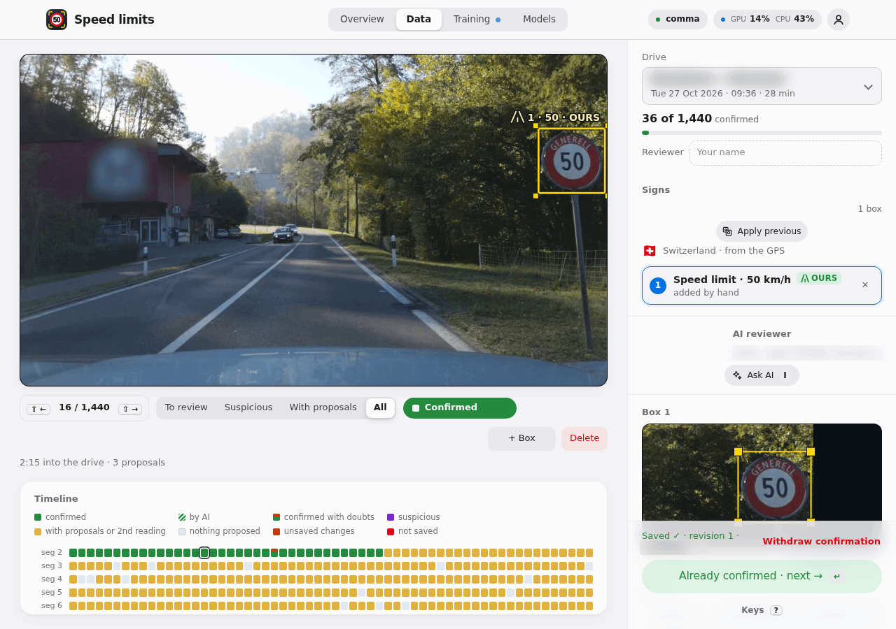
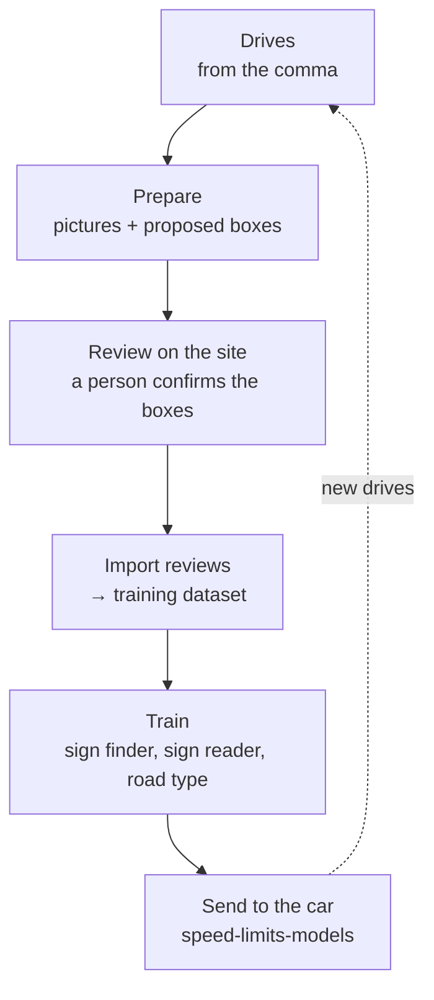
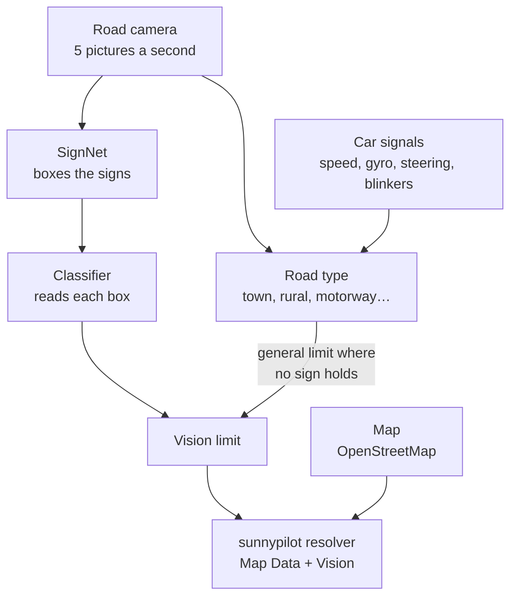
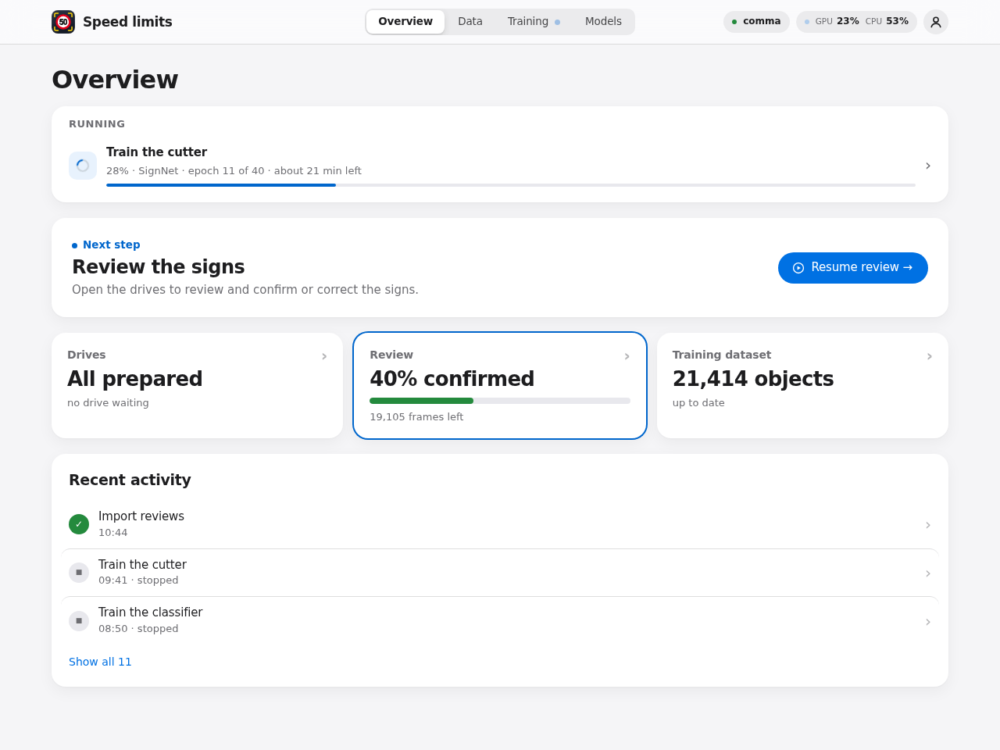
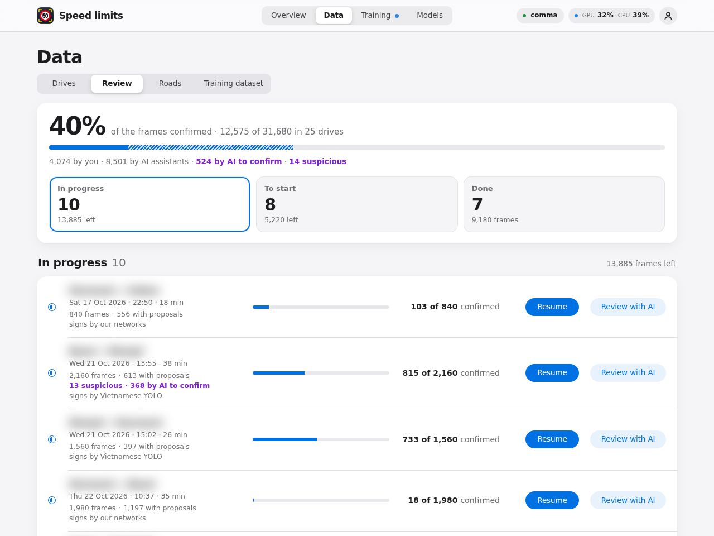
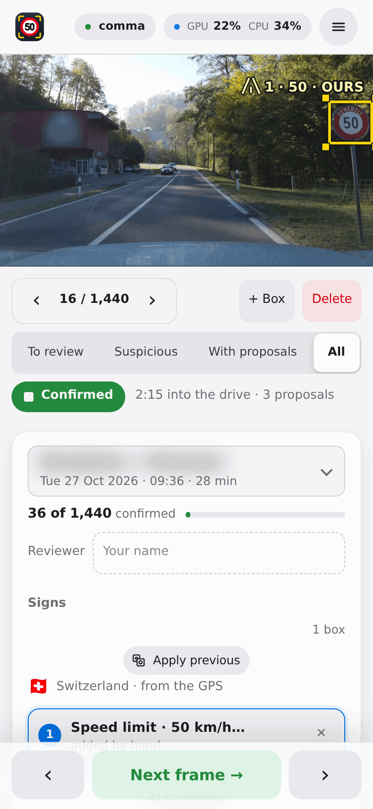
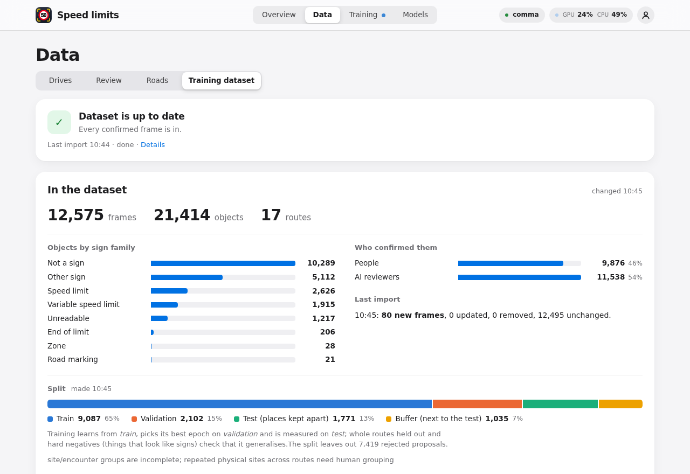
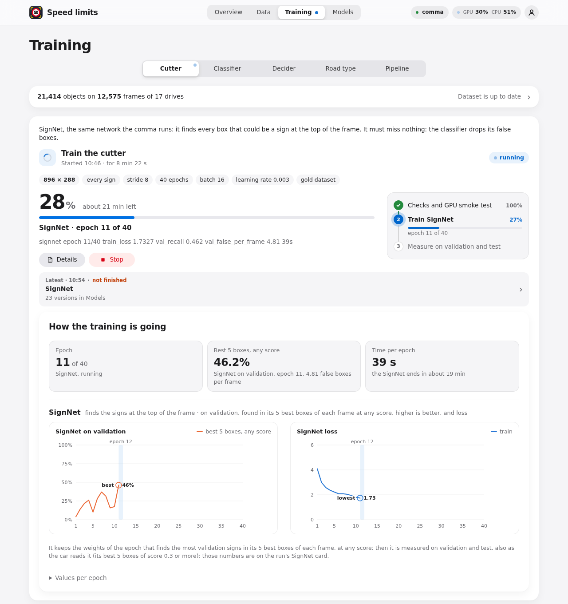
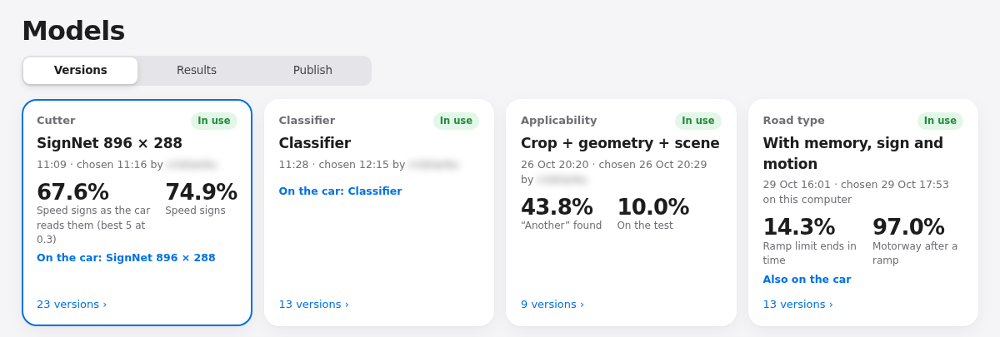
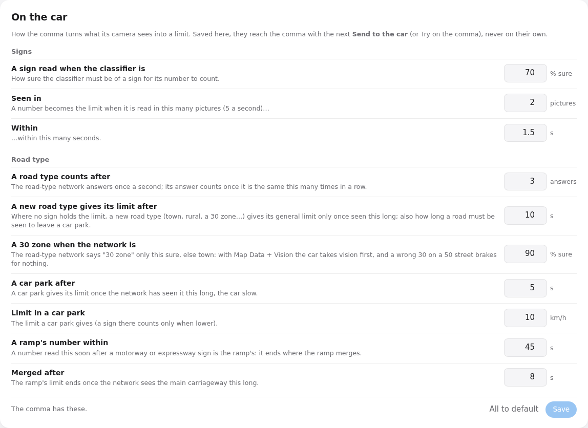

# sunnypilot.speedlimits

**A camera speed limit for sunnypilot**, an openpilot fork for driver assistance, on a comma 4. Small neural networks read the Swiss speed signs in the comma's road camera. This repository holds the website where drives are reviewed, and the tools that train those networks and send them to the car.



<sub>The review page. You check the box around each sign, and what the sign says.</sub>

> **Status: research.** A research build of sunnypilot runs these networks on Cristian's comma 4. The limit they read shows on the driving screen when sunnylink's **Show Vision Speed Limit** is on. Speed Limit Assist uses it only when the **Speed Limit Source** is **Map Data + Vision**: then the vision limit comes first, and the map fills in when vision has none. Details: [what runs on the comma now](docs/NN_VISION_SPEED_LIMIT_REMAINING_WORK.md#60-what-runs-on-the-comma-now-28-oct-2026).

[Why](#why) · [How it works](#how-it-works) · [Daily use](#daily-use) · [Install](#install) · [More](#more) · [Details](#details)

## Why

sunnypilot's Speed Limit Assist takes the limit from the car (when the car sends it on CAN) or from the map (OpenStreetMap). Many cars send nothing on CAN. Cristian's Peugeot 3008 is one of them, so the map is all it has.

Maps lag behind the road. Roadworks, variable motorway displays and new signs are often missing or wrong on the map. The sign at the roadside is what the driver must follow. A camera can see it.

## How it works

Three networks: the **sign finder** (SignNet, also called the *cutter*) puts a box around each sign, the **sign reader** (the *classifier*) reads each box, and the **road type** network says what kind of road the car is on.

From a drive to the car, in six steps:



- **Prepare** takes one picture a second from each drive. A model proposes a box around each sign it sees.
- **Review** is the only step done by hand. Every label the networks learn from is confirmed here.
- **Import reviews** copies the confirmed labels (the boxes and what each sign says) into the training dataset ([what it does](#4-import-the-reviews)).
- **Train** teaches the networks on a GPU on the server. The car never trains anything.
- **Send to the car** puts the networks into sunnypilot. The comma gets them with its next software update.

### What runs on the car



- **SignNet** looks only at a band at the top of the picture, where signs stand (896 × 288 pixels, a grid of 8 pixels). It keeps up to 5 boxes per picture.
- The **classifier** reads each box: a speed and its value, end of limit, another kind of sign, or "not a sign". A number counts once it is read in 2 pictures within 1.5 s.
- The **road type** network says what kind of road it is: town, 30 zone, rural, expressway, motorway, ramp or car park. Where no sign holds, that gives the country's general limit. In Switzerland: 50 in town, 80 rural, 100 expressway, 120 motorway, 10 in a car park.
- Everything runs inside the comma 4, on its own GPU, next to the driving model.
- **The vision side never reads the map.** It uses only the camera and the car's own signals. Map and vision meet only in sunnypilot's resolver, when the Speed Limit Source is **Map Data + Vision**.

## Daily use

Everything runs on the server. Most steps are a button on the site and also a script in `helpers/` or `scripts/`. Get the drives, Prepare and Import skip work that is already done; a training started again is a new run.



<sub>The Overview page: what is running, the next step, and how far each stage has got.</sub>

**At any time**, `helpers/status.sh` shows each drive, what is running, the GPU, the disk and the next command. It only reads.

### 1. Get the drives

On the site: the **comma** pill at the top right, then **Download new drives**. In a terminal: `helpers/fetch_comma_segments.sh`.

It copies new drives from the comma over SSH. It drops trips shorter than five minutes, the first and last two minutes of each trip, and any minute in reverse gear.

### 2. Prepare

On the site: **Data › Drives**, then **Prepare new drives**. In a terminal: `helpers/1_prepare.sh`.

It takes one picture a second, lets a model propose sign boxes, and reads the GPS position and country of each picture. **It takes a while and uses many CPU cores and the GPU.** You choose the model that proposes the boxes under **Found by**: Vietnamese YOLO (the default), Our networks, or Qwen3-VL (about 17 GB of GPU memory).

For the road type network, **Data › Roads › Find the road types** (`helpers/road_types.sh`) reads the kind of each road from OpenStreetMap, offline. These are training labels only: the car never sees the map.

### 3. Review

`helpers/2_review.sh` starts the site on port 8765 and prints its link. On the server it usually runs as the `speedlimits-web` service, always on.



<sub>Data › Review: how much is confirmed, and the drives to work on.</sub>

On each picture you:

- move, add or delete boxes;
- say what each sign is, and its speed;
- say whom it is for: **Ours**, **Another** road, or **Unclear**;
- press **Confirm**.

**Apply previous** (key A) copies the boxes of the picture before. **Fit box** (key C) snaps a rough box onto its sign, on the server in a fraction of a second, with no AI. It also works on a phone:



An AI that sees images can help. **Ask AI** (key I) suggests boxes and saves nothing. **Review with AI** goes through a whole drive; you still confirm its work before it counts. AI assistants such as Claude Code can also review through a REST API or MCP: see [review_instructions.md](review_instructions.md).

### 4. Import the reviews

On the site: **Data › Training dataset**, then **Import reviews**. In a terminal: `helpers/3_train.sh --dataset-only`.



<sub>Data › Training dataset: what the networks learn from, who confirmed it, and the split.</sub>

What it does:

1. It reads every **confirmed** picture in the review database. Model proposals and pictures nobody confirmed stay out. Pictures saved by the site's own AI reviewer (**Review with AI**) wait for a person, and stay out until confirmed. Reviews saved by an assistant through the REST API or MCP are final, and go in as AI reviews (`ai/<name>`).
2. It writes their labels into the training dataset (`data/annotations/objects.jsonl`). It follows the latest review: a picture reviewed again replaces its old rows, and a withdrawn one is removed. Old rows are archived in `data/annotations/replaced/`, not lost.
3. Boxes that reviewers deleted are kept as rejected proposals. The classifier learns from them as "not a sign".
4. It checks the dataset and splits it into **train**, **validation** and **test**. The test is a set of places kept apart, with a buffer of neighbouring places left out of both, so the networks are measured on roads they never learned.

It is quick and uses no GPU. **It trains nothing**: training is the next, separate step. Confirming a picture does not import it either.

### 5. Train

On the site: **Training**. There is one tab and one button per network. **They all use the GPU**, and only one training runs at a time.

- **Train the cutter** (SignNet): about 80 minutes.
- **Train the classifier**: a few hours. It learns from the false boxes of the cutter in use, so choose a cutter first.
- **Train the road type**: about 15 minutes (longer the first time). It needs **Find the road types** (step 2) to have run once. It needs no reviewed sign.
- **Train applicability** (is this sign for our road?): about 15 minutes. A prototype.



<sub>A cutter training, followed epoch by epoch.</sub>

Each training writes its results in `data/runs/<name>/`. Nothing is put in use by itself.

### 6. Choose and send to the car

On the site: **Models › Versions**. Every version has its test numbers. **Use this one** picks the version that the other steps use.



<sub>The networks in use, each with its main test numbers.</sub>

On the card of a SignNet:

- **Send to the car** publishes that SignNet, the classifier and the road type in use into the [`speed-limits-models`](https://github.com/cristianku/speed-limits-models) repository. That is a submodule of sunnypilot's `speed-limits` branch. It then rebuilds Cristian's sunnypilot test branch (`psa-torque-sunny-testing`), in a few minutes. On the comma: **Settings › Software › Check for updates**, then install.
- **Try on the comma now** copies that SignNet and the classifier in use straight onto a parked comma over SSH, after checking them with the comma's own code. The road type stays the build's. They last until the comma's next update. **Back to the build's networks** undoes it.

The **On the car** card holds the comma's settings: how sure a sign must be, in how many pictures, how long a road type must be seen. They travel with the next send.



<sub>Models › On the car: the comma's own settings, sent with the networks.</sub>

### Keep the site up to date

`helpers/update.sh` (or **Update the site** in the server pill at the top right) pulls the code, updates the Python environment when needed and restarts the site. Running trainings keep going.

## Install

You need Python 3.11 or newer. The core has no dependencies.

```sh
git clone https://github.com/cristianku/sunnypilot.speedlimits.git
cd sunnypilot.speedlimits
python3 -m venv .venv && .venv/bin/pip install -e . pytest
.venv/bin/nnslr selftest   # quick check, CPU only
.venv/bin/nnslr review     # the site, on this computer only
```

Without drives of your own the site is empty. [docs/INSTALL.md](docs/INSTALL.md) covers the system packages, the GPU environment, the comma's SSH access and the always-on service.

## Helpers, commands and scripts

Day-to-day work happens on the site, whose buttons run a few helper scripts and the `nnslr` command-line tool. [docs/COMMANDS.md](docs/COMMANDS.md) lists them all: what each one does, what it writes, and which ones use the GPU, install packages or publish anything.

- `helpers/1_prepare.sh`, `helpers/2_review.sh`, `helpers/3_train.sh`, `helpers/update.sh`: the daily steps above. `helpers/status.sh` only reads.
- `scripts/run_signnet.sh`, `scripts/run_classifier.sh`, `scripts/run_road_type.sh`, `scripts/run_experiment_b.sh`: the trainings of the Training page (GPU).
- `scripts/send_to_car.sh` and `scripts/try_on_comma.sh`: Send to the car and Try on the comma now.
- `helpers/ai_review.sh` and `helpers/measure_ai_reviewer.sh`: the AI reviewer. Its providers and keys stay on the server.
- `scripts/train_box_fit.sh`: trains the review page's **Fit box** on the boxes people drew, on the CPU in about 15 minutes.

## More

- [docs/GUIDE.md](docs/GUIDE.md): the daily guide, page by page, with sign-in, the token and common problems.
- [docs/COMMANDS.md](docs/COMMANDS.md): every helper, script and `nnslr` command, and what each one writes.
- [docs/INSTALL.md](docs/INSTALL.md): installing everything from scratch.
- [docs/NEURAL_NETWORK.md](docs/NEURAL_NETWORK.md): the networks, how they are measured, and the results.
- [docs/upstream-training-guide.md](docs/upstream-training-guide.md): the `nnslr` training commands, step by step.
- [review_instructions.md](review_instructions.md) and [docs/API_MCP.md](docs/API_MCP.md): for AI reviewers (REST API and MCP).
- [docs/DATASET.md](docs/DATASET.md): the dataset format and its rules.

## Details

### Where each part stands (30 October 2026)

- **Sign finder (cutter).** SignNet is the one cutter, on the car since 28 October. The one in use, trained on 30 October, finds 68% of the speed signs as the car reads them (IoU 0.5).
- **Classifier.** A version with "not a sign" is trained, measured, and on the car.
- **Road type.** A network with memory: the kind of road from the camera and the car's own motion, one answer a second, and the merge after a ramp. On the car ([details](docs/NEURAL_NETWORK.md#the-road-type-with-memory-29-october-2026)).
- **Applicability** (is this sign for our road, or for another one?). A prototype. Not on the car, so a side road's sign can be taken for ours.
- **Country rules.** The general limits (town, rural, expressway, motorway) of 22 countries are on the car, from [`docs/road-rules/`](docs/road-rules/README.md). The country is the one chosen in sunnypilot's settings (Switzerland by default). A small core with no dependencies ([`src/speed_vision_core`](src/speed_vision_core)) has the types and checks.
- [`integrations/sunnypilot`](integrations/sunnypilot/README.md) keeps an old, frozen advisory snapshot. It is not the runtime on the comma.

### One picture, step by step

Three separate networks, joined by a little code ([`chain.py`](src/nnslr_tools/chain.py)):

```
picture       3 × 760 × 1344
 → top band   3 × 288 × 896   (top 432 rows, scaled)
 → SignNet    best 5 boxes, score ≥ 0.3
 → crops      3 × 160 × 160 each, cut from the full picture
 → classifier one answer per box (50, end of 80, give way, not a sign…)
 → applicability  ours / another / not sure  (prototype, server only)
 → rules over time → the limit now
```

Signs are tiny: the median sign is 17 pixels wide. The top 416 rows of the picture hold 97% of the reviewed signs, so a sign lower down (a road marking, a low sign close by) is not found.

On the server the classifier gets all the boxes of a picture in one call. On the car each box is cut on the CPU and read on its own, at about 5 ms a box.

### Where it runs

Everything runs inside the comma 4, on its own GPU (tinygrad), in `speedvisiond`, at 5 pictures a second next to the driving model: SignNet takes about 12 ms a picture. Chestnut, comma's external GPU, was tried on 27 October and left to the driving model.

<details>
<summary><b>Results so far</b></summary>

First numbers: one country, one camera, a small test. Read them as a direction, not a promise. More in [NEURAL_NETWORK.md](docs/NEURAL_NETWORK.md#first-results-24-october-2026) and the [SignNet notes](docs/NN_VISION_SPEED_LIMIT_REMAINING_WORK.md#signnet-a-sign-finder-made-for-the-adreno-28-oct-2026).

**The data.** Now 25 drives and 31,680 pictures, 40% of them confirmed. The numbers below were measured on the data of 24 October: 11 drives in Switzerland, about 5.3 hours and 290 km, from a comma 4 (1344 × 760 road camera); about 8,900 pictures reviewed, most by AI reviewers; 1,818 sign boxes. 60% of the speed signs are narrower than 20 pixels.

**A fair test.** The drives keep returning to the same roads: 92 to 100% of each drive is covered by another one. So the test is split by place, not by drive: areas of about 300 m, with a ring of neighbouring areas kept out of both training and test.

**SignNet on the car** (28 October, test of 26 October: 381 signs, 208 of them speed signs):

- at the car's score of 0.3: 40% of all signs and 58% of speed signs found, 0.22 false boxes a picture;
- in its best 5 boxes at any score: 55% and 62%, with about 4.8 false boxes a picture.

**The old Detector** (SSDlite, whole picture, kept to compare): 6% of the speed signs at first, 79% at 960 × 544 and 81% at full size, after smaller default boxes and more pixels.

**An earlier classifier on its own** (24 October): 77.5% of speed signs read right, 98.2% of non-signs rejected, but 0 of 54 other signs recognised (all taken for "not a sign").

**The whole chain** (old 960 × 544 Detector + classifier, not yet measured with SignNet): 61% of the speed signs found **and** read right. False boxes drop from 41.5 to 0.26 a picture after the classifier.

**Applicability** (validation, only 17 "another road" signs): with the sign, its position and the car's speed it finds 77% of them and is right 65% of the time. Adding the whole scene made it worse: it memorised the places.

**What is weak:**

- Small signs: under 12 pixels, only 6 of 18 speed signs found and read right.
- Other signs: too few examples to learn them (34 boxes in training on 24 October).
- False signs: 0.26 a picture before the car's rule over time (2 pictures within 1.5 s); not yet measured after it.
- A small test, with mostly AI labels (about 95% of the reviewed pictures on 24 October), from one country and one camera. The comma 3X has another camera, so these networks would not work there as they are.
- Values are few: 60, 80, 100 and 50 km/h make nine in ten of the speed signs.

</details>

<details>
<summary><b>Full result tables (24–28 October)</b></summary>

**The data of 24 October**

| | |
|---|---|
| Kinds | 1,016 speed limits, 480 variable displays, 143 end of limit, 100 other signs, 38 unreadable, 28 zones, 13 road markings |
| Whom for | 1,594 for our road, 147 for another road, 79 unclear |
| Reviewed | About 8,500 pictures by AI reviewers (Claude Code, Codex, ChatGPT), just over 400 by a person; 1,818 boxes on 1,209 pictures |
| Test | 604 pictures (232 confirmed by a person), 134 signs: 80 speed signs, 54 other. "Found" means a box overlaps the reviewed one well (IoU ≥ 0.5) |

**SignNet at the car's score of 0.3** (test of 26 October)

| Band | Stride | All signs (of 381) | Speed signs (of 208) | Under 12 px (of 65) | False boxes a picture |
|---|---|---|---|---|---|
| 1344 × 416 | 4 | 110 (29%) | 108 (52%) | 13 (20%) | 0.05 |
| 1344 × 416 | 8 | 148 (39%) | 125 (60%) | 17 (26%) | 0.11 |
| **896 × 288 (car)** | 8 | **152 (40%)** | **120 (58%)** | 13 (20%) | 0.22 |
| 896 × 288 | 4 | 107 (28%) | 101 (49%) | 9 (14%) | 0.06 |
| 672 × 208 | 4 | 111 (29%) | 103 (50%) | 10 (15%) | 0.08 |

Only a SignNet at 896 × 288 and stride 8 runs on the car.

**The old Detector** (score 0.1, test of 24 October)

| Input | Boxes | Speed signs (of 80) | All signs (of 134) | Boxes a picture | V100 time |
|---|---|---|---|---|---|
| 320 × 320 | speed signs | 30 (38%) | – | 80 | 11.1 ms |
| 640 × 360 | speed signs | 50 (62%) | – | 238 | 11.3 ms |
| 960 × 544 | speed signs | 63 (79%) | – | 42 | 13.3 ms |
| 960 × 544 | every sign | 62 (78%) | 90 (67%) | 118 | 16.9 ms |
| 1344 × 760 | every sign | 65 (81%) | 90 (67%) | 210 | 47.6 ms |

The 1344 × 760 Detector by sign width: 11 of 18 under 12 px, 30 of 45 at 12–20 px, 27 of 35 at 20–40 px, 22 of 36 at 40 px and wider.

**The whole chain** (960 × 544 Detector + classifier): found by the cutter 63 of 80 (79%); read right once found 78%; found and read right 49 of 80 (61%), and 16 of 23 (70%) on pictures a person confirmed. By sign width: under 12 px 6 of 18, 12–20 px 16 of 31, 20–40 px 18 of 19, 40 px and wider 9 of 12.

**Applicability** (validation, 17 "another road" signs)

| What it sees | Found (of 17) | Right when it says "another road" |
|---|---|---|
| The sign alone | 10 (59%) | 50% |
| + box position and size, car speed | 13 (77%) | 65% |
| + the whole scene | 10 (59%) | 31% |

</details>

### How you can help

- **Drives** on new roads, in other countries, at dusk, at night, in rain, or from a comma 3X. Recordings are private, so please [open an issue](https://github.com/cristianku/sunnypilot.speedlimits/issues) first.
- **Reviewing.** Confirmations by a person are the most valuable labels.
- **The load on the comma 4.** Measuring how much room the networks leave next to the driving model.
- **Country rules.** How signs are read where you drive (town entries, motorway defaults, zones).
- **Code and ideas.** Issues and pull requests are welcome.

### Data and privacy

- Drives, pictures, the review database, datasets and checkpoints stay out of git. There is no public dataset.
- Everything runs on one server. GPS comes from the comma's own logs, OpenStreetMap from a local extract, offline. No drive position is sent anywhere.
- The first and last two minutes of every trip are dropped at download.
- Place names, shop signs and reviewer names in the screenshots are blurred.
- The site's access token lives in `.env`, which git ignores. Keep the site on a home network or behind an SSH tunnel.

<details>
<summary><b>Licences</b></summary>

- This repository is MIT ([LICENSE](LICENSE)). Its tooling came from [openpilot-nnslr-tools](https://github.com/cristianku/openpilot-nnslr-tools) (MIT, same author): see [NOTICE.md](NOTICE.md) and [provenance/import.json](provenance/import.json).
- The frozen sunnypilot snapshot in [`integrations/sunnypilot/snapshot/`](integrations/sunnypilot/snapshot/) keeps its notices: comma.ai's MIT licence and the sunnypilot custom licence, in [LICENSES/](LICENSES/).

  This project uses software from Haibin Wen and SUNNYPILOT LLC and is licensed under a custom license requiring permission for use.

- The networks are in the public [`speed-limits-models`](https://github.com/cristianku/speed-limits-models) repository for testing, with no licence for general use yet. Before that, their terms must be checked: the classifier starts from ImageNet weights (non-commercial research), the drives are private, and some boxes were first proposed by models with restrictive licences (below).

</details>

<details>
<summary><b>Credits</b></summary>

- [comma.ai](https://comma.ai) and [openpilot](https://github.com/commaai/openpilot) (MIT): the device that records the drives, and its log formats.
- [sunnypilot](https://github.com/sunnypilot/sunnypilot) and its Speed Limit Assist, which this work feeds.
- [PyTorch and torchvision](https://pytorch.org) (BSD-3-Clause): MobileNetV3, the old SSDLite Detector and the ImageNet weights. SignNet is our own, trained from scratch. [tinygrad](https://github.com/tinygrad/tinygrad) (MIT) runs the networks on the comma.
- Pre-annotation models, which only propose boxes for review. They are downloaded at run time with a SHA-256 check, never committed:
  - [`star092304/traffic-sign-detection-vietnam-yolo`](https://huggingface.co/star092304/traffic-sign-detection-vietnam-yolo) (YOLO, 82 classes of Vietnamese signs). Its model card says Apache-2.0, but the model file says AGPL-3.0. Not resolved.
  - [`Xenova/segformer-b0-finetuned-cityscapes-1024-1024`](https://huggingface.co/Xenova/segformer-b0-finetuned-cityscapes-1024-1024), from NVIDIA SegFormer. [NVIDIA's licence](https://github.com/NVlabs/SegFormer/blob/master/LICENSE) allows non-commercial research only; Cityscapes has its own terms.
  - [RapidOCR](https://github.com/RapidAI/RapidOCR) 3.4.0 with PaddleOCR PP-OCRv4 (Apache-2.0), for numbers painted on the road.
- The [Mapillary Traffic Sign Dataset](https://www.mapillary.com/dataset/trafficsign) (CC BY-NC-SA 4.0): optional extra sign crops for the classifier (`helpers/mapillary.sh`, off by default). Never committed; a classifier trained with it carries its non-commercial terms.
- The table of Mapillary's old image keys and current ids, [viajerus/mapillary_keys_ids](https://github.com/viajerus/mapillary_keys_ids), shared on the [Mapillary forum](https://forum.mapillary.com/t/mapillary-traffic-sign-dataset-keys/10282); positions from the [Mapillary API](https://www.mapillary.com/developer/api-documentation).
- Map data © [OpenStreetMap contributors](https://www.openstreetmap.org/copyright), ODbL, read offline.
- Country borders from [Natural Earth](https://www.naturalearthdata.com) (public domain).
- The site is built with [Vue 3](https://vuejs.org) (MIT), Vite and TypeScript.

</details>
