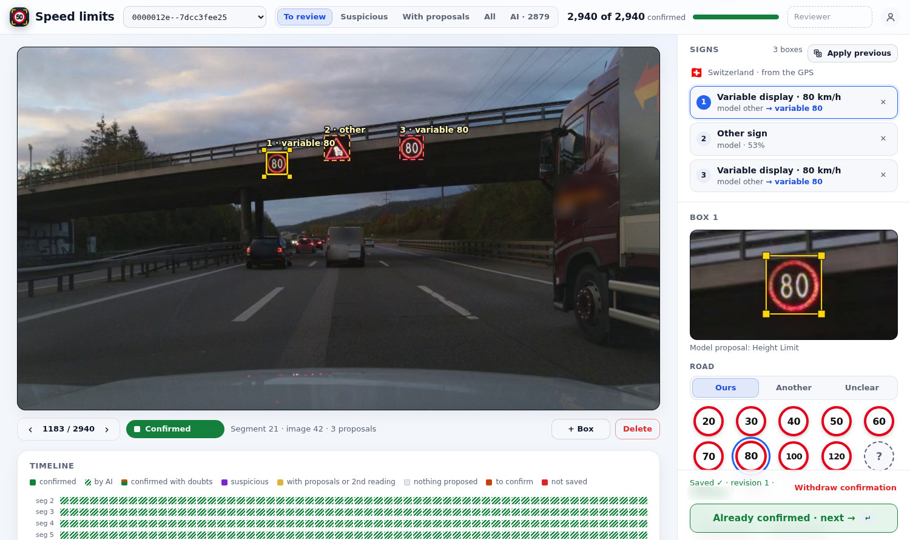
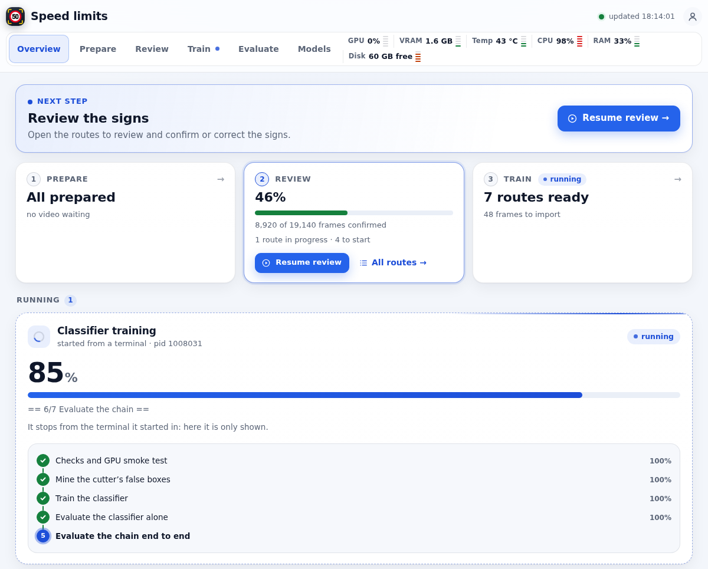
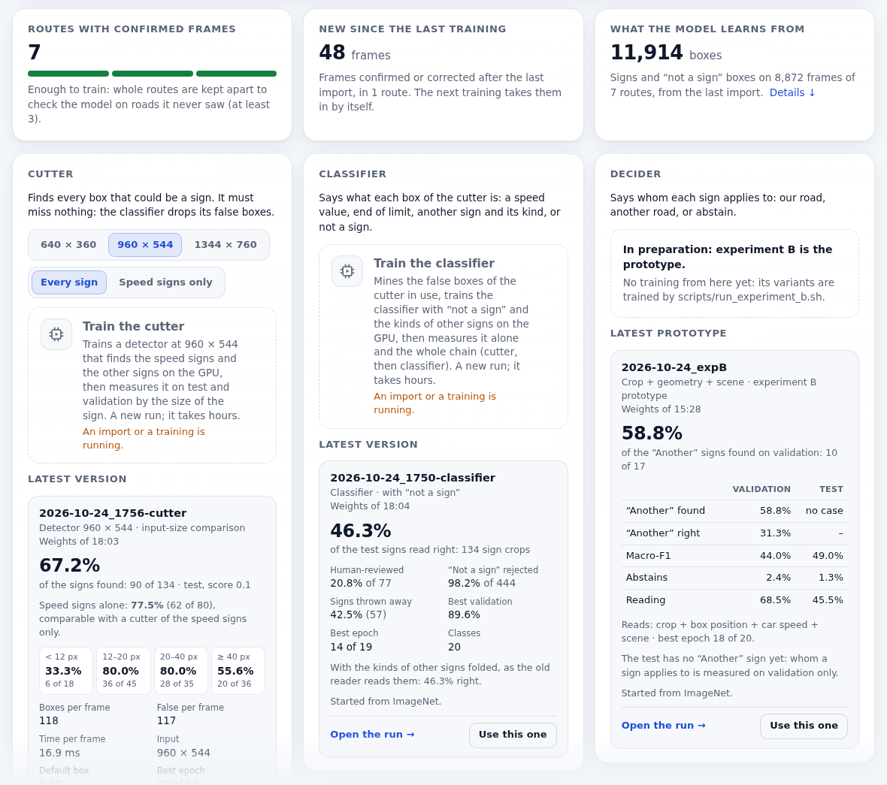
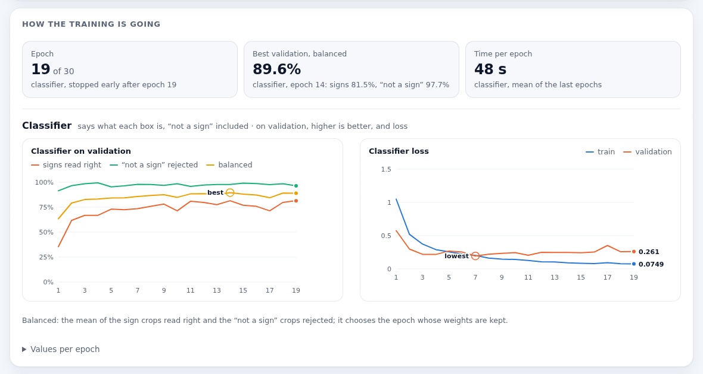
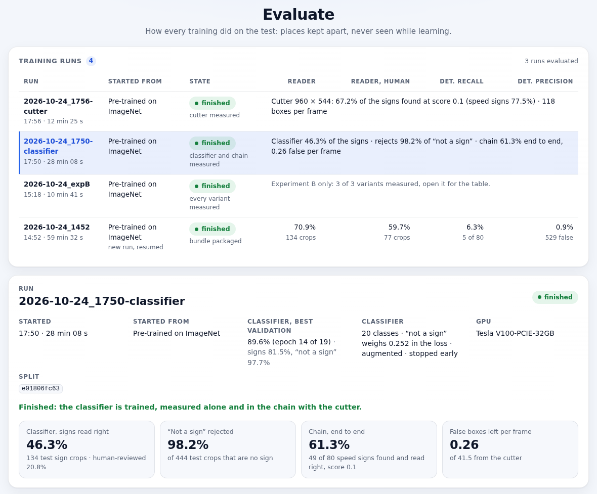
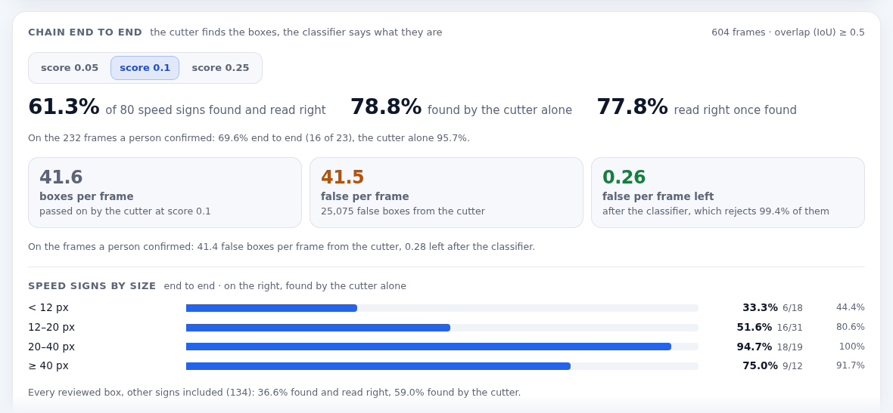
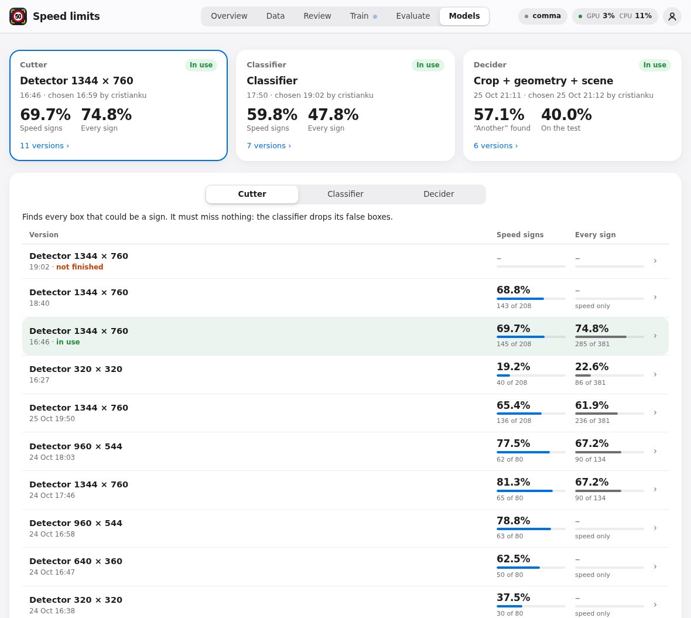

# sunnypilot.speedlimits

**Reading speed-limit signs with the comma's road camera, for sunnypilot's Speed Limit Assist.**

This project teaches small neural networks to find the speed-limit signs in the road camera of a comma device, read them, and work out whether they apply to the road the car is on. The goal is a third source for sunnypilot's Speed Limit Assist, next to the map and the car. The repository also contains a web portal where drives are prepared, signs are reviewed by people and by AI assistants, and networks are trained, measured and chosen.

> **Status: research.** Nothing runs in a car yet, and no trained weights are published. When it does reach a car, it will start out advisory only: the limit it reads is shown on screen and does not change the car's speed.

<picture>
  <source media="(prefers-color-scheme: dark)" srcset="docs/images/review-dark.jpg">
  <source media="(prefers-color-scheme: light)" srcset="docs/images/review-light.jpg">
  
</picture>

<sub>The review page (see [Review a route](#review-a-route)): two variable 80 km/h displays and a danger sign on a Swiss motorway bridge, boxed and labelled. Number plates are blurred.</sub>

[Why](#why) · [How it works](#how-it-works) · [The portal](#the-portal) · [Results so far](#results-so-far) · [How you can help](#how-you-can-help) · [Getting started](#getting-started)

## Why

sunnypilot's Speed Limit Assist takes the current limit from the car, when the car reports it on CAN, and from the map (OpenStreetMap). Many cars report no limit on CAN. The author's Peugeot 3008 is one of them, so there the map is the only source.

Maps lag behind the road. Roadworks, variable motorway displays, temporary limits and recently changed signs are often missing from the map, or wrong there. The sign at the roadside is what the driver has to follow. A camera source would let sunnypilot see the same sign, and notice when the map is out of date.

## How it works

The job is split into small steps. Each network is trained, measured and replaced on its own, so it is always clear which part fails.


<sub>The pipeline as planned on 24 October 2026. The cutter box still shows the very first detector, which found 6% of the signs. The cutter in use now finds 81% of the test speed signs (see [Results so far](#results-so-far)).</sub>

1. **Cut.** The cutter looks at each frame of the main road camera (1344 × 760 pixels on the comma four) and draws a box around anything that could be a sign. It must miss nothing. False boxes are fine, because the next step drops them. Signs are tiny: in these drives the median sign is 17 pixels wide.
2. **Classify.** The classifier gets each box, cut from the full-resolution frame, and says what it is: a speed limit and its value, end of limit, zone, variable display, a limit too blurred to read, another kind of sign (town entry, give way, direction and so on), or not a sign at all.
3. **Decide.** The decider says whom each sign is for: our road, another road (an exit ramp, a parallel road, the other carriageway), or "not sure", in which case it abstains. It looks at the recognised signs, where they are in the image, and the car's speed.
4. **Follow over time.** The same sign is followed from frame to frame as the car gets closer, so the reading steadies and the system knows when the sign has been passed. In the car only past frames exist, so this step never looks ahead.
5. **The limit now.** The current limit is kept by plain rules, not by a network, so the reason for every limit stays visible: which sign set it, and how sure that reading was. The country, from the GPS, decides how a sign is interpreted, because a town-entry sign implies a different limit in different countries.

### One frame, step by step

Three separate networks, joined by a little code ([`chain.py`](src/nnslr_tools/chain.py) on the server). Each network is called **once per frame**: the classifier gets all the boxes of the frame together, as one batch, not one call per box.

```
frame [3, 760, 1344]
  │
  ▼  cutter (SSDlite, MobileNetV3-Large)          1 call
boxes [N, 4] + scores                             N ≈ 40, false ones included
  │
  ▼  cut each box from the full-resolution frame, resize to 160 × 160
crops [N, 3, 160, 160]                            stacked into one tensor
  │
  ▼  classifier (MobileNetV3-Small)               1 call for all N
classes [N]                                       50, end of 80, give way, …, not a sign
  │
  ▼  drop "not a sign"; the rest with position and size, the car's speed and steering
  ▼  decider (MobileNetV3-Small, a prototype)    1 call for all the signs of the frame
road [M]                                          ours / another / abstain
  │
  ▼  rules over time, with the country from the GPS
the limit now
```

Why one call for all the boxes: a network is mostly matrix multiplications. N crops stacked as N rows go through every layer in the same single pass, the weights are read once, and the GPU fills its cores. 40 crops take about as long as 1; 40 calls would take 40 times longer. On the server the cutting is still a Python loop on the CPU; in the car it becomes one GPU operation (`torchvision.ops.roi_align`), so frame → cutter → crops → classifier never leaves the GPU and can be exported as a single model.

All training happens on a server with one GPU (a Tesla V100). The networks trained there are the ones for the car (see [Chestnut](#where-it-would-run-chestnut)) and the ones that propose the signs of new drives (Prepare, "Our networks"). On the server a drive can also be looked at with its later frames, its GPS and the map, which the car cannot do: that is the "teacher" step, meant to make better proposals and help training.

| Step | Where it stands (24 October 2026) |
|---|---|
| Cutter | Trained and measured. One version is chosen in the portal. |
| Classifier | A first version with "not a sign" is trained and measured. None is chosen yet. |
| Decider | Prototypes (experiment B). The one chosen sets the road of Our networks' proposals. |
| Following over time | Computed on the reviewed frames, not yet on the networks' output. |
| Limit state and country rules | Planned. A small core with no dependencies ([`src/speed_vision_core`](src/speed_vision_core)) already has the types, the validation and the temporal checks. |
| sunnypilot | No working integration. [`integrations/sunnypilot`](integrations/sunnypilot/README.md) keeps an old, frozen advisory snapshot that only ever reports "unavailable". |

The plan for sunnypilot is a Vision option next to Car and Map in Speed Limit Assist's source setting. At first it would only show the limit on screen. It would use only fresh, confident signs that apply to our road, and ignore stale or uncertain ones.

### Where it would run: Chestnut

The networks are sized for Chestnut, comma's external GPU, and not for the comma four's own chip. To fit that chip, the frame would have to shrink so much that distant signs, already under 20 pixels wide, disappear. At 320 × 320 the cutter found 38% of the test speed signs, and at full resolution it finds 81%. Chestnut has far more compute. It also runs openpilot's driving model, though, and the driving model always comes first. How much room is left next to it, and how a second model can share it, still has to be measured. Nothing has run on Chestnut, or in a car, yet.

## The portal

Daily work happens in a web portal served by this repository, by default on port 8765. Its six tabs follow the order of the work: Overview, Prepare, Review, Train, Evaluate and Models. Jobs started from the portal run on the server, show their progress live and can be stopped. The portal has a light and a dark theme, and the pictures below follow your GitHub theme. On a home network it asks for a name and a password. It is not meant to be reachable from the internet.

### Overview

<picture>
  <source media="(prefers-color-scheme: dark)" srcset="docs/images/overview-dark.png">
  <source media="(prefers-color-scheme: light)" srcset="docs/images/overview-light.png">
  
</picture>

Where things stand and what to do next. A banner names the next step. Three cards show how far preparing, reviewing and training have got: here, 46% of 19,140 frames are confirmed. Every running job lists its steps with live progress; a finished one is a row of the latest jobs. On every page, a pill at the top right says how busy the server is ("Server idle", "GPU 85%"); tap it for the GPU, its memory and temperature, the CPU, the memory and the free disk.

### Prepare

This tab turns drives on the comma into frames ready for review, automatically, with two buttons. **Download from the comma** copies new drives over SSH. It leaves out trips shorter than five minutes, the first and last two minutes of every trip, and any minute in reverse gear. **Prepare new drives** extracts one frame per second, lets pre-annotation models propose sign boxes, and reads the GPS position and country of every frame. A table shows the state of each route.

### Review a route

The review page is the picture at the top of this page. This is the one step done by hand, and the heart of the project: every label the networks learn from is confirmed here.

- **Boxes.** The models' proposals are drawn on the frame. You move, add or delete boxes, and the selected box opens as a sharp, full-resolution crop. The model's own guess is shown, but only as a hint: in that picture it took an 80 km/h display for a height limit.
- **What each box is.** For each box you set the kind of sign: speed limit, variable display, end of limit, zone, road marking, unreadable limit, not a sign, or another sign with its kind (town entry, give way, roundabout, directions and more). You also set the value in km/h, and whom the sign is for: **Ours**, **Another** road, or **Unclear**.
- **Country from the GPS.** The frame's country is proposed from its GPS position, and you confirm or correct it.
- **Apply previous** (key A) carries the confirmed boxes of the frame before onto this one. A sign it cannot find gets a box marked "check", and the frame cannot be confirmed until you have looked at each one.
- **Timeline and filters.** A timeline colours every frame of the drive by its state. Filters jump to the frames still to review, to those flagged as suspicious (for example where a second model sees a sign the first one missed), or to those an AI reviewed. On some frames a second model offers its own reading, which you should use only if you see it too.

**AI reviewers.** A review can also be done by an AI that sees images. Under **Settings → AI reviewer** you connect any OpenAI-compatible server, a hosted provider or your own llama.cpp server with a vision model, and choose the one that reviews. On the review page, **Ask AI** (key I) shows its suggestion for the frame. The suggestion saves nothing: **Apply** turns it into edits that you check, and your **Confirm** saves them. On the route list, **Review with AI** has the AI go through every frame still open, either as a trial or saving its reviews. AI assistants such as Claude Code or Codex can also review without a browser, through a REST API (`/api/v1`) or an MCP server: the assistant runs on its own computer, looks at each image, and saves through the same checks as the page. Every save records who made it (a person, or an AI as `ai/<name>`) and through which channel. An AI cannot change a frame a person confirmed without an explicit override. A confirmation by an assistant through the REST API or MCP needs no second approval by a person, and stays marked as an AI review in the dataset. What the site's own AI reviewer saves (**Review with AI**, a server of Settings) waits for you instead: the review page shows those frames as **AI · to confirm**, the route list counts them, and they go into training only once you confirm them. Details are in [docs/API_MCP.md](docs/API_MCP.md) (in Italian).

### Train, network by network

<picture>
  <source media="(prefers-color-scheme: dark)" srcset="docs/images/train-networks-dark.png">
  <source media="(prefers-color-scheme: light)" srcset="docs/images/train-networks-light.png">
  
</picture>

The Train tab has one card per network:

- **Cutter.** Pick the input size (640 × 360, 960 × 544 or the full 1344 × 760, the default) and whether it boxes every sign or only speed signs, then press **Train the cutter**.
- **Classifier.** **Train the classifier** collects the cutter's false boxes, trains the classifier with "not a sign", and measures it on its own and together with the cutter.
- **Decider.** **Train the decider** trains experiment B's three variants (the crop alone, with position and speed, with the scene) in about 15 minutes, and compares them. It is a prototype; the one in use (Models) sets OURS or another on the speed signs Our networks propose.

Two more buttons cover the dataset and the older pipeline. **Import reviews** turns the confirmed frames into the dataset. **Whole pipeline** runs the older detector-and-reader baseline, from the import to a packaged model.

<picture>
  <source media="(prefers-color-scheme: dark)" srcset="docs/images/train-charts-dark.png">
  <source media="(prefers-color-scheme: light)" srcset="docs/images/train-charts-light.png">
  
</picture>

While a network trains, charts follow it epoch by epoch on the validation set and mark the epoch whose weights are kept.

### Evaluate

<picture>
  <source media="(prefers-color-scheme: dark)" srcset="docs/images/evaluate-dark.png">
  <source media="(prefers-color-scheme: light)" srcset="docs/images/evaluate-light.png">
  
</picture>

This tab lists every training run with its numbers on the test set, which is made of places the networks never saw while learning. Open a run to see what it was trained on, how the classifier does on its own, and how the whole chain does. Runs can be compared side by side.

<picture>
  <source media="(prefers-color-scheme: dark)" srcset="docs/images/evaluate-chain-dark.png">
  <source media="(prefers-color-scheme: light)" srcset="docs/images/evaluate-chain-light.png">
  
</picture>

The chain card answers the question that matters: how many of the test's speed signs are found **and** read right. It also shows how many false boxes survive per frame, and how both change with the size of the sign and the cutter's threshold.

### Models

<picture>
  <source media="(prefers-color-scheme: dark)" srcset="docs/images/models-dark.png">
  <source media="(prefers-color-scheme: light)" srcset="docs/images/models-light.png">
  
</picture>

For each network (cutter, classifier and decider), this tab lists every version trained here, each with its main test number and the rest under **Details**, and the one in use. **Use this one** records the choice, with who made it and when. Other steps then use that version: for example, the classifier training learns from the false boxes of the cutter in use. Choosing copies, exports or installs nothing.

**Publish**, under the three columns, shares the three networks in use with other people, together, on Hugging Face:

- **Prepare the package** exports them to ONNX, checks each against PyTorch, and writes a model card with their test numbers. It runs here and uploads nothing.
- **Publish on Hugging Face** uploads the latest package to `cristianku/sunnypilot-speedlimits-models`, public, after a question, and adds it to the catalog `speed_networks.json` that a car can download from. No frame or dataset leaves the server.
- The Hugging Face account is connected in **Settings → Hugging Face**: a wizard creates a token with Write access, checks it and keeps it on the server ([docs/INSTALL.md](docs/INSTALL.md#publishing-a-model-on-hugging-face)).

The commands are in [docs/COMMANDS.md](docs/COMMANDS.md#publishing-when-there-is-something-to-publish).

## Results so far

These are the first measurements, taken on 24 October 2026. The dataset is small and comes from one country. Most of it was labelled by AI reviewers, and everything is measured on a single test area. Read the numbers as a direction, not a promise.

### The data

| | |
|---|---|
| Drives | 11 drives in Switzerland, about 5.3 hours and 290 km, recorded by a comma four (main road camera, 1344 × 760) |
| Frames | 19,140, one per second |
| Reviewed | About 8,900 frames (46%), between 21 and 24 October 2026: about 8,500 by AI reviewers (Claude Code, Codex, ChatGPT), and just over 400 by a person |
| Signs | 1,818 boxes on 1,209 frames. Another 7,665 reviewed frames have no sign at all. |
| Kinds | 1,016 speed limits, 480 variable displays, 143 end of limit, 100 other signs, 38 unreadable, 28 zones, 13 road markings |
| Size | The median sign is 17 pixels wide, and 60% of the speed signs are narrower than 20 pixels. |
| Whom for | 1,594 for our road, 147 for another road, 79 unclear |

<sub>The sign counts come from the dataset imported on 24 October, which covers 8,872 frames.</sub>

**A test the networks never saw.** The drives keep returning to the same roads. Each drive is cut into stretches of about 300 m, and for every drive, 92 to 100% of its stretches are covered by another drive too. A test made of whole drives would therefore check the networks on signs they had already learned. So the split is by place instead. Frames are grouped in areas of about 300 m, and the test takes the areas of one drive. A ring of neighbouring areas is kept out of both training and testing. The test has 604 frames (232 of them confirmed by a person), with 134 signs: 80 speed signs and 54 other signs. Below, "found" means that a box overlaps the reviewed box well (IoU ≥ 0.5).

### Finding the signs (cutter)

This table shows how many test signs each cutter finds, at a cutter score of 0.1:

| Cutter input | Learns to box | Speed signs found (of 80) | All signs found (of 134) | Boxes passed on per frame | Time per frame on a V100 |
|---|---|---|---|---|---|
| 320 × 320 | speed signs | 30 (38%) | – | 80 | 11.1 ms |
| 640 × 360 | speed signs | 50 (62%) | – | 238 | 11.3 ms |
| 960 × 544 | speed signs | 63 (79%) | – | 42 | 13.3 ms |
| 960 × 544 | every sign | 62 (78%) | 90 (67%) | 118 | 16.9 ms |
| **1344 × 760 (in use)** | every sign | **65 (81%)** | **90 (67%)** | 210 | 47.6 ms |

The very first detector, at 320 × 320 with its default settings, found 5 of the 80 speed signs (6%). Smaller default boxes and more pixels did the rest. The cutter in use reads the full frame and boxes every kind of sign, so that the classifier also learns the other signs. By sign width, it finds 11 of 18 signs under 12 px, 30 of 45 at 12 to 20 px, 27 of 35 at 20 to 40 px, and 22 of 36 at 40 px and wider. The times are for the network alone on a server GPU, and say little about the car.

### Reading the signs (classifier) and the whole chain

This is the classifier on its own, on the reviewed boxes of the test:

| | Test |
|---|---|
| Speed signs read right | 62 of 80 (77.5%). The older reader, without "not a sign": 64 of 80 (80%) |
| Boxes that are not a sign, rejected | 436 of 444 (98.2%) |
| Other signs (town entry, directions and so on) | 0 of 54: all taken for "not a sign" |

The next table shows the whole chain on the test frames, the cutter followed by the classifier, at a cutter score of 0.1. This chain was measured with the 960 × 544 cutter that boxes speed signs only. The full-resolution cutter now in use has not been measured in the chain yet.

| Cutter score 0.1 | Test |
|---|---|
| Speed signs found **and** read right | **49 of 80 (61%)** |
| Found by the cutter | 63 of 80 (79%) |
| Read right, once found | 78% |
| Found and read right, on frames a person confirmed | 16 of 23 (70%) |
| False boxes per frame | 41.5 from the cutter, **0.26** after the classifier (99.4% rejected) |
| Found and read right, by sign width | under 12 px: 6 of 18 · 12 to 20 px: 16 of 31 · 20 to 40 px: 18 of 19 · 40 px and wider: 9 of 12 |

### Whom a sign is for (decider prototype)

Experiment B trained three small variants on the reviewed boxes. The test has no sign for another road yet, so this is measured on the validation set, which has only 17 of them:

| What the network sees | "Another road" signs found (of 17) | Right when it says "another road" |
|---|---|---|
| The sign alone | 10 (59%) | 50% |
| The sign, the position and size of its box, and the car's speed | 13 (77%) | 65% |
| All of the above, plus the whole scene | 10 (59%) | 31% |

Position and speed help. The whole scene hurt: that variant reached 99.7% on the training data, because it memorised the places.

### What is weak

- **Small signs.** Under 12 pixels, only 6 of 18 speed signs are found and read right.
- **Other signs.** The classifier calls every one of them "not a sign". Training had only 34 boxes of other signs.
- **False signs.** 0.26 per frame is still about one false sign every four frames. Following signs over time and keeping a limit state are meant to filter these out, but neither has been built or measured on the networks' output yet.
- **A small test.** There is one test area with 80 speed signs, so a single sign moves a result by more than a point.
- **Mostly AI labels.** About 95% of the reviewed frames were confirmed by AI reviewers. The test leans on human reviews (232 of its 604 frames), but not only on them.
- **Narrow data.** All drives come from one country and one camera, and they cover the same roads again and again. Values are few: 60, 80, 100 and 50 km/h make up nine in ten of the readable speed limits. The comma 3X has a different camera (1928 × 1208, another lens), so these networks would not work there as they are.
- **Whom a sign is for.** There are 147 "another road" boxes in total: 17 on validation and none on the test.
- **No device numbers.** Nothing has been measured on Chestnut yet.

## How you can help

This is a small research project, and anyone is welcome to try it or improve it. There are no promises about timelines.

- **Drives.** The most useful recordings are on new roads, in other countries, at dusk, at night and in rain, and also drives from a comma 3X. Recordings are private by nature, so please [open an issue](https://github.com/cristianku/sunnypilot.speedlimits/issues) first, and we can agree on how to share them.
- **Reviewing.** Confirmations by a person are the most valuable labels, especially for the test. If you would like to review, open an issue.
- **Chestnut.** If you have one, measuring how much room it leaves next to the driving model would settle the biggest open question.
- **Country rules.** Tell us how signs are interpreted where you drive (town entries, motorway defaults, zones), for the rules that keep the current limit.
- **Code and ideas.** Issues and pull requests are welcome, and so is feedback on the approach in the sunnypilot community.

## Getting started

You need Python 3.11 or newer. The core has no dependencies. Optional extras add pre-annotation, comma log reading and GPU training.

```sh
git clone https://github.com/cristianku/sunnypilot.speedlimits.git
cd sunnypilot.speedlimits
python3 -m venv .venv && .venv/bin/pip install -e . pytest
.venv/bin/nnslr selftest     # quick check on synthetic data, CPU only
.venv/bin/nnslr review       # the portal on http://127.0.0.1:8765, this computer only
```

Without drives of your own, the portal is empty. [docs/INSTALL.md](docs/INSTALL.md) covers the system packages, the optional extras, the GPU environment and running the portal as a service. [docs/COMMANDS.md](docs/COMMANDS.md) covers everything else.

## Helpers, commands and scripts

Day-to-day work happens in the portal, whose buttons run a few helper scripts and the `nnslr` command-line tool. [docs/COMMANDS.md](docs/COMMANDS.md) lists them all, with what each one does, what it writes, and which ones use the GPU, install packages or publish anything.

Two helpers belong to the AI reviewer. `helpers/ai_review.sh` (**Review with AI**) reviews a route with the provider chosen in Settings. `helpers/measure_ai_reviewer.sh` (**Measure** in Evaluate → AI reviewers) measures a provider on the same frames people reviewed. Neither takes a key as an argument: the providers and their keys stay on the server, in `data/web/private/llm-providers.json`. An AI review saved by **Review and save** waits for a person: the import leaves it out until you confirm the frame. Providers can also be added from a terminal with `nnslr llm-provider add` ([docs/INSTALL.md](docs/INSTALL.md)).

## Data, privacy, licences and credits

### Data and privacy

- Drive recordings, frames, the review database, datasets and checkpoints are private and stay out of git. There is no public dataset, and no trained weights are published.
- Everything runs on one server. GPS positions are read from the comma's own logs, and OpenStreetMap from a local extract, offline: no position from the drives is sent anywhere.
- When drives are downloaded, the first and last two minutes of every trip are dropped.
- In the screenshots here, number plates, lettering on vehicles and reviewer names are blurred.
- The portal's access token lives in a `.env` file that git ignores. Keep the portal on a home network or behind an SSH tunnel.

### Licences

- This repository is under the MIT licence ([LICENSE](LICENSE)). Its tooling was imported from [openpilot-nnslr-tools](https://github.com/cristianku/openpilot-nnslr-tools) (MIT, same author). See [NOTICE.md](NOTICE.md) and [provenance/import.json](provenance/import.json).
- The frozen sunnypilot runtime snapshot in [`integrations/sunnypilot/snapshot/`](integrations/sunnypilot/snapshot/) keeps its original notices: comma.ai's MIT licence and the sunnypilot custom licence, both in [LICENSES/](LICENSES/).

  This project uses software from Haibin Wen and SUNNYPILOT LLC and is licensed under a custom license requiring permission for use.

- No trained weights are published. Before any are, their terms must be checked, for three reasons. They start from ImageNet-pretrained weights, and the ImageNet dataset is licensed for non-commercial research. The drives they learn from are private. And some of the boxes were first proposed by models with restrictive licences (listed below).

### Credits

- [comma.ai](https://comma.ai) and [openpilot](https://github.com/commaai/openpilot) (MIT), for the device that records the drives and the log formats read here.
- [sunnypilot](https://github.com/sunnypilot/sunnypilot) and its Speed Limit Assist, which this work is meant to feed.
- [PyTorch and torchvision](https://pytorch.org) (BSD-3-Clause), for the SSDLite and MobileNetV3 networks and the ImageNet-pretrained weights they start from.
- The pre-annotation models, which only propose boxes for review. They are downloaded at run time with a SHA-256 check, never committed, and not part of the trained models:
  - the traffic-sign detector [`star092304/traffic-sign-detection-vietnam-yolo`](https://huggingface.co/star092304/traffic-sign-detection-vietnam-yolo) (YOLO, 82 classes of Vietnamese signs). Its model card says Apache-2.0, but the model file's own metadata says AGPL-3.0. This has not been resolved.
  - the road segmentation [`Xenova/segformer-b0-finetuned-cityscapes-1024-1024`](https://huggingface.co/Xenova/segformer-b0-finetuned-cityscapes-1024-1024), an ONNX conversion of NVIDIA SegFormer. [NVIDIA's licence](https://github.com/NVlabs/SegFormer/blob/master/LICENSE) allows non-commercial research and evaluation only, and the Cityscapes dataset has terms of its own.
  - [RapidOCR](https://github.com/RapidAI/RapidOCR) 3.4.0 with the PaddleOCR PP-OCRv4 models (Apache-2.0), for numbers painted on the road.
- Map data © [OpenStreetMap contributors](https://www.openstreetmap.org/copyright), under the ODbL, read offline to find the roads near the drives.
- Country borders from [Natural Earth](https://www.naturalearthdata.com) (public domain).
- The portal is built with [Vue 3](https://vuejs.org) (MIT, bundled into the built pages), Vite and TypeScript.
