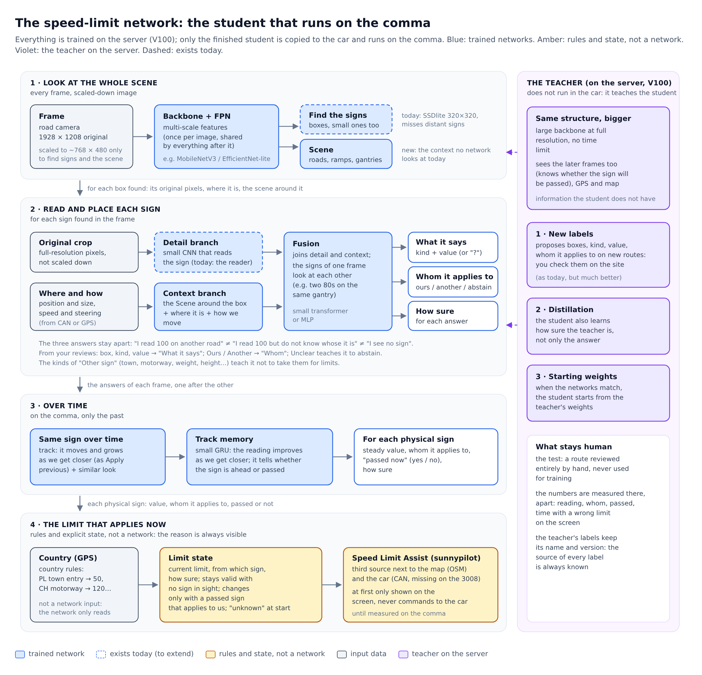

# The speed-limit network: diagram and plan

A proposal of 24 October 2026, to discuss: nothing here is implemented yet. It starts from Codex's "teacher and student" proposal and from the real data on the server.

## Where things run

**All training happens on the server**, on the V100. The comma never trains anything.

- **The teacher** is a big network. It is trained on the server and only ever runs there: it labels new drives and helps train the student.
- **The student** is a small network. It is also trained on the server, from the reviews and from the teacher. When it is finished it is copied to the car, and it runs on the comma while driving: it reads the camera and shows the limit. It learns nothing in the car, and it sees only the past, since there are no future frames while driving.

## The student

1. **Look at the whole scene.** A backbone with FPN runs on the image scaled down to about 768 × 480, once per frame, and is shared by everything after it. It gives two things:
   - the boxes of the signs, at several scales because distant ones are small;
   - the features of the scene: roads, ramps, gantries.
2. **Read and place each sign.** For each box found:
   - the **detail branch** reads the crop cut from the original full-resolution pixels, never from the scaled-down image (today the reader does this);
   - the **context branch** looks at the scene around the box, where it is and how the car moves;
   - **fusion** joins the two, and the signs of one frame look at each other (two 80s on the same gantry).

   There are three separate answers: **what it says** (kind and value, or "?"), **whom it applies to** (ours, another, or abstain), and **how sure** it is of each.
3. **Over time**, with the past only: the same sign is followed from frame to frame, as "Apply previous" does. A small memory per track improves the reading as the car gets closer, and tells whether the sign is ahead or passed.
4. **The limit that applies now.** This is rules and explicit state, not a network, so the reason for a limit is always visible.
   - The country comes from the GPS. Country rules interpret what the network reads (a town entry in Poland means 50).
   - The limit logic is written and tested here, in `speed_vision_core`, and replayed offline on the recorded routes.
   - Only after that does it go into sunnypilot. That separate change adds a process on the comma that runs the student, and makes Speed Limit Assist take it as a third source next to the OSM map and the car's CAN, which the 3008 does not have. At first the limit is only shown on the screen.

## Why the image is scaled down

The scaled-down image is only used to **find** the signs and to understand the scene. **Reading** always uses the original pixels of the box.

The reason is the comma's budget. The full 1928 × 1208 frame has about 6× more pixels than 768 × 480, and the driving model already uses most of the device; openpilot's own driving model also works on a reduced image.

The risk is the distant sign: 20 px wide at full resolution, it becomes about 8 px at 768, and the finder can miss it. There are three ways around this:
- a second pass at full resolution on the band of the image where the signs are (above the road, around the horizon), which costs far less than the whole frame;
- running the finder a few times a second instead of 20 times;
- once a sign is found, following it with the tracker and cropping it at full resolution.

The size that is enough is measured, not guessed: how many signs of each size are found at 640, 768 and 1024 pixels, with and without the full-resolution band (step 3 of the plan).

## The teacher

The teacher has the same structure, bigger and at full resolution. It also sees the later frames, the GPS and the map. It is used in three separate ways:
- **new labels**, which a person checks on the site;
- **distillation**: the student also learns how sure the teacher is;
- **starting weights**.

The test stays human: a route reviewed entirely by hand, never used for training.

## The plan

| Step | What | Why |
|---|---|---|
| 1. Data | Crops of the signs at full resolution (1928 × 1208); one test route reviewed entirely by hand; "Another" cases collected on purpose (ramps, parallel roads, exits), proposed by GPS and map; the link "Apply previous" makes between boxes kept as tracks; split by place (GPS) as well as by route | The frames are stored at 1344 × 760 today, and a distant sign is 5–8 px at the detector; there are only 125 "Another" against 1463 "Ours"; human labels cover about 121 frames |
| 2. Experiment B | On the boxes already reviewed: today's reader against crop + position + scene, with reading and "whom it applies to" measured apart on the human test, and "Unclear" taught as abstain | It tells whether context teaches "whom it applies to" without hurting the reading, before building the rest |
| 3. Detector | Boxes found automatically, at several scales and at higher resolution in the upper part of the image; missed signs counted by size | A sign that is not found cannot be recovered later |
| 4. Time and state | Tracks, "passed or not" and the limit state on whole routes; time with a wrong limit on the screen measured | The limit must stay valid when the sign is out of sight |
| 5. Comma | Export of the student; latency and memory measured on the device (Cristian installs it) | The driving model comes first |

## Second opinion (strata)

strata, a local model, agrees on these points:
- a human test set first;
- crops at full resolution;
- a finder at 480–640 px followed by full-resolution crops;
- an explicit limit state that says "unknown";
- 1 frame per second is too sparse for tracking.

It added two points, both taken: "Unclear" should be taught as abstain rather than dropped, and 125 "Another" are too few for a network alone, so that case also needs geometry, rules and targeted collection. It wanted experiment B only after the detector. B deliberately uses reviewed boxes, so it measures context without detector errors, and it stays first.

## Open decisions

- "Ours" stays "our carriageway"; a lane label comes later, for gantries with different values per lane.
- Which route is reviewed entirely by hand for the test.
