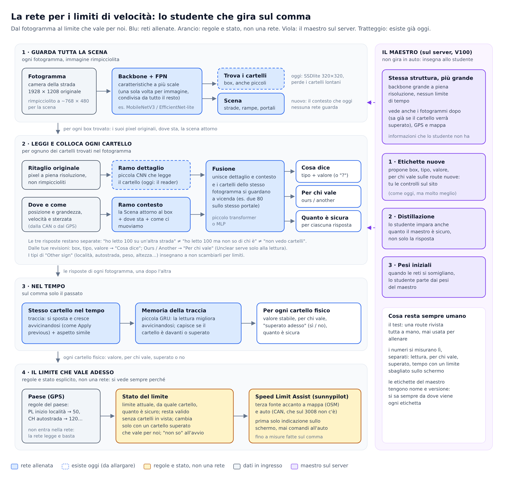

# La rete per i limiti di velocità: schema e piano

Proposta del 24 ottobre 2026, da discutere: non è ancora implementata. Parte dalla proposta "maestro e studente" di Codex e dai dati reali del server.

## Lo studente (gira sul comma)

1. **Guarda tutta la scena.** Un backbone con FPN sull'immagine rimpicciolita (~768 × 480), calcolato una volta per fotogramma e condiviso. Da lì escono due cose: i box dei cartelli, a più scale perché quelli lontani sono piccoli, e le caratteristiche della scena (strade, rampe, portali).
2. **Legge e colloca ogni cartello.** Per ogni box trovato:
   - il **ramo dettaglio** legge il ritaglio preso dai pixel originali, non da quelli rimpiccioliti (oggi lo fa il reader);
   - il **ramo contesto** guarda la scena attorno al box, dove sta e come si muove l'auto;
   - la **fusione** li unisce, e i cartelli dello stesso fotogramma si guardano a vicenda (due 80 sullo stesso portale).

   Tre risposte separate: **cosa dice** (tipo e valore, o "?"), **per chi vale** (ours / another), **quanto è sicura**.
3. **Nel tempo**, solo col passato: lo stesso cartello viene seguito da un fotogramma all'altro, come fa "Apply previous". Una piccola memoria per ogni traccia migliora la lettura avvicinandosi e dice se il cartello è davanti o superato.
4. **Il limite che vale adesso.** Regole e stato esplicito, non una rete: si vede sempre perché un limite è attivo.
   - Il paese viene dal GPS. Le regole del paese interpretano quello che la rete legge (inizio località in Polonia = 50).
   - Il risultato va a Speed Limit Assist come terza fonte, accanto a mappa e auto. All'inizio solo indicazione sullo schermo.

## Il maestro (sul server)

Stessa struttura ma più grande, a piena risoluzione. Vede anche i fotogrammi successivi, il GPS e la mappa. Serve a tre cose, che restano distinte:
- **etichette nuove**, che tu controlli sul sito;
- **distillazione**: lo studente impara anche quanto il maestro è sicuro;
- **pesi iniziali**.

Il test resta umano: una route rivista tutta a mano e mai usata per allenare.

## Il piano

| Passo | Cosa | Perché |
|---|---|---|
| 1. Dati | Ritagli dei cartelli a piena risoluzione (1928 × 1208); una route di test rivista tutta a mano; casi "Another" cercati apposta (rampe, strade parallele, uscite); salvare il collegamento di "Apply previous" (stesso cartello nel tempo); split anche per luogo, dal GPS | Oggi i fotogrammi sono 1344 × 760 e un cartello lontano ha 5–8 pixel al detector; ci sono solo 125 "Another" contro 1463 "Ours"; le etichette umane sono circa 121 fotogrammi |
| 2. Esperimento B | Sui box già annotati: il reader di oggi contro ritaglio + posizione + scena, con lettura e appartenenza misurate separatamente sul test umano | Dice se il contesto insegna "per chi vale" senza peggiorare la lettura, prima di costruire il resto |
| 3. Detector | Box trovati in automatico a più scale e risoluzione più alta nella parte alta dell'immagine; misura dei cartelli persi per grandezza | Un cartello non trovato non si recupera dopo |
| 4. Tempo e stato | Tracce, "superato o no", stato del limite su route intere; misura del tempo con un limite sbagliato sullo schermo | Il limite deve restare valido quando il cartello non si vede più |
| 5. Comma | Esportazione dello studente; latenza e memoria misurate sul dispositivo (le installazioni le fa Cristian) | Il modello di guida ha la precedenza |

## Da decidere

- "Ours" resta "la nostra carreggiata"; la corsia si aggiunge solo dopo, per i portali con valori diversi per corsia.
- Quale route rivedere tutta a mano per il test.
